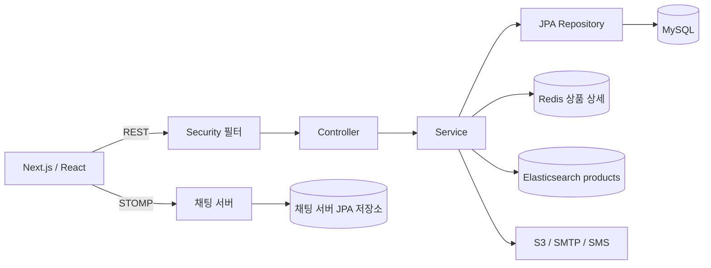

# NGNG-backend 구조 및 리팩토링 분석

분석일: 2026-11-04 (Asia/Seoul). 소스 정적 분석 완료, 런타임 검증 미완료.
기준 커밋·실행 결과는 [BASELINE.md](BASELINE.md), 작업 분해는 [BACKLOG.md](BACKLOG.md)를 따른다.

## 1. 범위와 근거

루트 AGENTS.md, 리팩토링 README·양식·PROMPTS, 백엔드 README·빌드·배포 설정을 확인했다. 하위 AGENTS.md는 발견되지 않았다. 다른 두 저장소의 문서와 관련 코드는 연동 확인에만 사용했다. README의 외부 이미지·ERD 원본과 운영 배포 환경은 검증하지 않았다. 과거 README의 Redis/Elasticsearch 성능 개선 설명을 현재 측정 결과로 사용하지 않는다.

아래 Java 경로는 별도 표시가 없으면 `NGNG-backend/src/main/java/com/ngng/api/` 기준이며 행 번호는 분석 당시 기준이다. **정적 확인**은 코드·설정에서 직접 확인했다는 뜻이며 실행 성공을 뜻하지 않는다. **결함 경로**는 특정 입력에서 코드상 문제가 발생하는 경로이며 실제 HTTP 결과는 미재현이다. **가설**은 동시성 결과·SQL 수·성능·운영 인프라 등 추가 검증이 필요한 사항이다.

## 2. 구조와 빌드

루트는 Git 저장소가 아니며 세 프로젝트가 독립 Git 저장소다. 공통 분석 문서는 세 저장소의 Git 이력에 자동 포함되지 않는다.

| 항목 | 확인한 내용 | 근거 |
|---|---|---|
| 백엔드 | 단일 Gradle 프로젝트, 이름 api, Java 17, Spring Boot 3.2.4 | `build.gradle`, `settings.gradle` |
| 빌드 | Wrapper 8.7, dependency-management 1.1.4, Maven Central, JUnit Platform | `gradle/wrapper/gradle-wrapper.properties`, `build.gradle` |
| 패키지 | ApiApplication 아래 기능별 controller/service/repository/entity/dto | product, user, transaction, report, penalty, search, log, global |
| 프런트엔드 | Next.js 14.1.4, React 18 범위 의존성, TypeScript, SWR, STOMP | `NGNG-frontend/package.json` |
| 채팅 | 별도 Java 17 / Boot 3.2.4; WebSocket, AMQP, JPA 의존성 | `NGNG-chat-server/build.gradle` |
| 배포 | Docker 빌드에서 `build --exclude-task test`; 실행 시 외부 application-prod.yml과 TARGET 사용 | 백엔드 `Dockerfile:9-25` |
| CI | develop push → 이미지 빌드/push → SSH deploy.sh; 별도 테스트 단계 없음 | 백엔드 `.github/workflows/deploy.yml` |

의존성은 Spring Web/Validation/Security/JPA/Redis/Elasticsearch/Mail, MySQL 드라이버, Lombok, JJWT 0.11.5, springdoc-openapi-ui 1.6.11, Thumbnailator 0.4.20, Spring Cloud AWS 2.2.6.RELEASE, Nurigo SDK 4.2.7, reactor-core다. 테스트는 starter-test와 spring-security-test다. 실제 해석된 전이 의존성·취약점은 미조사다. springdoc/AWS의 Boot 3 조합과 reactive Elasticsearch 설정/동기 검색 API의 빈 구성은 시작 검증 대상으로 남긴다. 현재 호환성 오류가 발생했다고 단정하지 않는다. 신규 라이브러리나 업그레이드는 이번 계획에 포함하지 않는다.

## 3. 주요 기능과 호출 경계

두 서버가 product/user/public_chat/거래 관련 테이블을 각각 매핑한다. 동일 물리 DB 공유 여부는 운영 접속 설정 대조가 필요하다. 그림은 MySQL→ES 동기화를 보장하지 않는다.

| 기능 | 확인한 호출 관계·트랜잭션 | 계약과 경계 |
|---|---|---|
| 가입 | JoinController → JoinService.join → 사용자 저장 + PointHistoryService.createInitByUser; join에 Transactional | BCrypt, UNCONFIRMED_USER 역할, 초기 포인트 이력 |
| 인증 | SecurityConfig → LoginFilter/TokenFilter → JwtTokenProvider/Verifier; AuthService는 이메일로 사용자 재조회 | Authorization Bearer 접두사, refreshToken 쿠키. 인가와 필터 제외 규칙이 별도 |
| 계좌·주소·탈퇴 | ConfirmService/DropOutService가 요청 ID로 수정 | 계좌 확인 시 USER 역할·토큰 발급. 소유권 확인은 별도 검토 |
| 상품 | ProductController → ProductService → ProductRepository/TagService; 서비스 클래스에 Transactional | 등록 201+Location+ID, 상세 부재는 컨트롤러상 404, 수정은 DTO |
| 이미지 | ProductController.fileUpload → UploadService → CompressService/AwsS3Service → 이미지·썸네일 서비스 | 상품 등록과 다른 요청. S3와 DB 저장 여러 단계 |
| 상세 조회 | ProductService.read → Redis 또는 JPA → DTO | 이미지·태그·사용자·분류·상태·채팅·신고까지 캐시 |
| 검색 | main/category/search 서비스 → ES | main 60개, category/search 20개. main만 forSale 조건 |
| 거래 요청 | create는 중복 조회 후 저장; update는 수락 → 판매중지 → 거래생성 → 다른 요청 거절 | 수락 update에 Transactional. 중복 생성 요청은 -1 |
| 거래 상태 | TransactionDetailsService.updateTransactionStatus → 거래/사용자/상태 조회 → 상태 수정 | Transactional, 숫자 상태 ID 기준 데이터 의존 |
| 포인트 | PointController → PointHistoryService → 최신 이력 조회 → 새 이력 저장 | 확인과 결제는 별도 요청. 쓰기 서비스 트랜잭션·잠금 없음 |
| 신고·패널티 | ReportServiceImpl CRUD; PenaltyTran은 패널티/신고/판매상태를 한 트랜잭션에서 변경 | 패널티 1/2/3, 거래 상태 6 등 숫자 ID에 의미 결합 |
| 관리자·로그 | 사용자/신고 페이지 5개; 사용자마다 포인트 조회; 6개 Log*Service가 파일 파싱 | 사용자 목록은 Page DTO, 로그 페이지는 파일 줄 순서 |

프런트 `next.config.mjs:19-39`는 `/api/*`, `/products/*`, `/transaction/*`를 백엔드로 rewrite한다. `src/app/admin/users/page.tsx:35-62`는 content/pageable.pageNumber/pageable.pageSize/totalPages를 사용한다. `src/app/my_page/_api/api.ts`는 포인트 확인·결제·거래 상태 변경을 따로 호출한다. `src/app/chat/_api.ts`는 거래 요청 API를 사용하고 상품 채팅 컴포넌트는 STOMP를 사용한다. 백엔드에서 채팅 서버를 호출하는 HTTP 클라이언트는 발견되지 않았다. README의 “상품 등록과 채팅방 생성”을 하나의 원자적 서버 간 작업으로 해석하지 않는다.

## 4. 발견 사항

### F01 — 회귀 검증 기반 공백 (정적 확인, P0 선행)

- 9개 테스트 파일 모두 SpringBootTest, 7개는 addFilters=false. 보안 정책 검증 근거로 사용할 수 없다.
- `src/test/.../user/UserControllerTest.java:232-235`는 UserUpdateRequestDTO의 2인자 생성자를 사용하지만 DTO는 4개 필드의 Lombok 전체 생성자와 무인자 생성자만 갖는다(`user/user/dto/UserUpdateRequestDTO.java:7-16`). 실제 컴파일러 출력은 미확보다.
- 고정 사용자 이메일·상품·거래 ID에 의존하며 fixture/seed SQL은 발견되지 않았다. ProductControllerTest.fileUpload:119-122는 빈 테스트, UserControllerTest.sendMessage:158에는 Test 애너테이션이 없다.
- SearchControllerTest:52의 `/product/{category}/{page}`는 현재 `/category/{category}/{page}`와 다르다. 성공 상태 위주 검증, 주석 처리된 assertion이 있다.
- 테스트 YAML은 ddl-auto:update, 외부 접속·자격 정보 리터럴을 포함하고 테스트가 이메일 발송 경로도 호출한다. 해당 YAML에는 RedisCacheConfig가 요구하는 spring.redis.host/port가 없다. 외부 설정 보완 여부는 미확인이다.

### F02 — 포인트·거래 정합성 위험 (구조 확인, 결과 미재현, P0)

- `PointHistoryService:56-105`는 최신 이력 잔액을 읽고 계산한 값을 새 이력으로 저장한다. `PointHistoryRepository:15-19`는 ID 내림차순이 최신 기준이다. 사용자별 직렬화·Version·명시적 Lock은 발견되지 않았다. 같은 잔액을 읽는 동시 요청은 증감분 일부가 최신 잔액에 반영되지 않을 가능성이 있다. 실제 DB 제약은 미확인이다.
- `isPaymnet:77-85`는 잔액 > 결제액이며 payment는 재검사하지 않는다. 음수·잔액과 같은 금액·초과 결제·재시도의 의도된 정책은 미확정이다.
- `TransactionRequestService:25-39,44-73`에는 이미 수락한 요청의 재처리 방어가 없다. 동시 수락 시 중복 거래 시도/제약 위반 가능성이 있다. Transactional만으로 경쟁 조건을 해결하지는 못한다.
- 프런트의 결제와 거래 상태 변경은 별도 요청이므로 실패 순서에 따른 부분 성공을 검증해야 한다.

### F03 — 인증·인가 및 응답 정보 경계 (코드 경로 확인, P0)

- `TokenFilter:42-60`은 Authorization null에서 isEmpty 호출, refresh 쿠키 부재에서 Optional.get 호출 경로가 있다. `JwtTokenVerifier:53-66`은 만료 외 파싱 예외를 처리하지 않는다.
- `TokenFilter:126-136`은 검증을 OR로 연결해 타입 확인이 필수가 아니다. 이후 claim 파싱도 서명을 검증하므로 “임의 위조 토큰 인증 우회”로 단정하지 않는다. 유효하게 서명된 잘못된 타입·누락·변조·만료를 필터 포함 테스트로 확인해야 한다.
- `SecurityConfig:93-111`은 미지정 경로 permitAll이지만 TokenFilter가 따로 실행된다. permitAll만으로 모든 API가 익명 접근 가능하다고 판단하지 않는다.
- `TransactionDetailsService:120-123`은 Long ID를 !=로 비교한다. 동일 값의 다른 객체를 잘못 거부할 수 있는 결함 경로다.
- 상품 수정/삭제는 역할 제한이 있으나 ProductService.update/delete에 소유자 확인이 없다. ConfirmService/DropOutService의 요청 ID 사용도 점검 대상이다. 정책 변경은 별도 합의가 필요하다.
- `PointController:23-44`는 PointHistory 엔티티를 반환하고 `PointHistory:41-43`은 User를 참조한다. `User:12-29`에는 password getter가 생성되며 Jackson 제외 표시가 없다. 신고 응답도 User를 포함한다(`ReportServiceImpl:48-59`). 기본 직렬화상 민감 필드 노출 위험이며 실제 payload는 미확인이다. 상품 UserDTO는 id/name/nickname만 담는다.
- 이메일/SMS 서비스는 발송한 인증번호를 응답에 포함한다. JoinService에는 서버 측 인증번호 검증 흐름이 없다. 변경은 가입 흐름·프런트 계약 변경으로 별도 취급한다.

### F04 — 상품 캐시 무효화와 데이터 소유 범위 (정적 확인, P1)

- `RedisCacheConfig:43-49`의 기본 TTL은 30분, JSON 직렬화다. 설정값이며 실제 노후화 시간 측정값은 아니다.
- `ProductService:42,131`의 read/update만 캐시 애너테이션을 쓴다. updateForSale/updateRefresh/delete, 이미지 변경, PenaltyTran의 상품 직접 수정에는 무효화가 없다. 상세 DTO에 포함된 사용자 이름·신고·채팅 변경도 캐시와 연결되지 않는다.
- 채팅 서버 PublicChatService가 public_chat을 저장/수정/숨김 처리한다. 동일 데이터를 공유한다면 백엔드만 수정해 전체 정합성을 보장할 수 없다. 실제 DB 연결과 변경 주체 확인이 선행되어야 한다.
- Product.from은 status/category를 ID만 있는 객체로 바꾸며 update는 즉시 DTO를 캐시에 넣는다(`ProductService:130-145,183`, `Product:120-138`). 이름 null 캐싱, 커밋·캐시 쓰기 순서 및 롤백 동작을 검증해야 한다.

### F05 — 조회 비용 (반복 호출 확인, 성능 미측정, P1)

- `UserService.findAll(Integer):53-63`은 페이지 사용자마다 PointHistoryService.readCostByUser → PointHistoryRepository.findLastByUserId를 호출한다. N명에 대해 N회 추가 repository 호출 구조는 확인했지만 전체 SQL 수는 미측정이다. 목록/count/role 로딩이 있어 총 SQL을 N+1로 단정하지 않는다.
- `Product:66-95`의 다수 연관을 상세 변환이 순회한다(`ProductService:184-253`). 추가 select, 큰 응답·캐시 값, 직렬화 비용 후보지만 실제 쿼리 수는 미확인이다.
- 상품 무페이지 findAll, 마이페이지 판매·구매 이력은 개수 제한이 없다. 상품 무페이지/페이지 경로는 visible 필터도 달라 일괄 페이징/필터 변경은 계약 변경이다.
- readOnly 경계가 일관되지 않고 서비스 밖 DTO 변환도 있다. 실제 OSIV 설정은 미확인이다. 전체 LAZY 전환이나 fetch join은 페이지 중복·Cartesian 증가·지연 로딩 실패를 조회별로 검증한 뒤 진행한다.

### F06 — 예외·빈 결과 계약 불일치 (결함 경로 확인, P1)

- `ProductService:48-51,81-90`은 빈 목록에 null을 반환하지만 `ProductController:128-137`은 바로 isEmpty를 호출한다. 빈 DB/페이지에서 NPE 경로가 있다. 컨트롤러의 204 분기가 실제 204를 보장하지 못한다.
- updateForSale/updateRefresh는 부재 처리 뒤 null 역참조, ReportServiceImpl.findById도 null 역참조, UserService.adminUserUpdate에는 orElseThrow(null)이 있다.
- 전역 ControllerAdvice는 없고 일부 컨트롤러에 BadRequestException 처리만 있다. 일괄 404/400 통일은 오류 계약 변경이므로 endpoint별 재현·정책 확인이 먼저다.
- ProductService.delete의 주석과 OR 조건, ReportServiceImpl.delete의 visible=true, DropOutService의 visible 토글은 의도 확인 항목이다. 이름만 보고 수정하지 않는다.

### F07 — 책임·객체 설계·중복 (정적 확인, P2)

- `TransactionDetailsService:27`의 extends Exception은 서비스 역할과 무관한 상속이다. 제거 전 사용 참조를 확인해야 한다.
- ProductService는 CRUD와 여러 응답 매핑을 함께 맡고 Product는 웹 요청 DTO에 의존한다. 전역 setter로 변경 규칙이 흩어진다. 전면 재설계보다 유스케이스 단위 분리가 적절하다.
- ProductService.readAll 두 overload의 매핑, AuthService/UserService의 readAuthUser, UploadService/ReportImageUploadService 업로드가 중복된다. 사용되지 않는 메서드는 호출자를 먼저 확인한다.
- 6개 Log*Service는 경로 외 파일 읽기·파싱·페이지 조립이 거의 동일하다. 기존 필터/총건수 의미를 보존하는 작은 공통 구성요소 후보다. 단일 구현 인터페이스를 더 늘릴 근거는 없다.

### F08 — 파일·외부 I/O (정적 확인, 성능 가설, P1/P2)

- `Log*Service.readLog:23-40`은 페이지 추출 뒤 별도 스트림으로 전체 줄 수를 센다. 요청마다 전체 파일을 읽으며 logback은 RollingFileAppender 없이 FileAppender를 쓴다. 실제 파일 크기·지연은 미측정이다.
- 파싱 실패 줄은 content에서 빠지지만 totalCount에 포함된다. 두 번 읽는 사이 파일 증가도 가능하다. 정리 시 이 의미를 임의 변경하지 않는다.
- UploadService는 첫 이미지 본문/썸네일을 각각 디코딩한다. CompressService는 매번 워터마크를 파일에서 읽고 BufferedImage/byte[]를 만든다. CPU·메모리·S3 시간을 분리 측정해야 한다.
- Docker 최종 이미지에는 JAR만 복사하지만 `CompressService:37,57`은 ./images/water 파일을 요구한다. 외부 volume 보완이 없으면 실패할 수 있다. 실제 배포 환경은 미확인이다.
- S3 성공 후 DB 실패·복수 파일 중 일부 실패의 보상 경로가 없다. DB 트랜잭션만 추가해도 S3는 롤백되지 않는다. 실제 장애 사례는 미확인이다.

### F09 — 검색 동기화·환경의 불확실성 (P1)

- ProductsDocument는 products 인덱스와 nori 분석기를 요구한다. MySQL→ES 갱신 작업·Logstash 설정은 저장소에서 발견하지 못했다. 운영 동기화가 없다는 뜻은 아니다.
- category/keyword 검색에는 main과 같은 forSale 조건이 없고 ES 문서에 visible 필드가 없다. 노출 정책과 외부 색인 필터 확인이 필요하다.
- main resources에는 실행용 application YAML이 없고 Git ignore 대상이다. 테스트 YAML의 자격 정보 관련 리터럴은 유효성을 확인하지 않았고 문서에 복사하지 않는다.

## 5. 판단

안전한 개선을 가장 크게 제한하는 것은 회귀 검증 기반 부재다. 데이터·인증 위험은 최상위로 추적하되 정책이 불명확한 수정을 외부 동작 유지 리팩토링에 섞지 않는다. 첫 작업 RF-001은 테스트 기반 확보다. 이후 사용자 목록처럼 좁고 비교 가능한 조회 후보를 측정해 개선한다. 캐시·결제·권한은 별도 명세에서 불변 조건과 실패·동시성 테스트를 먼저 확보한다.
